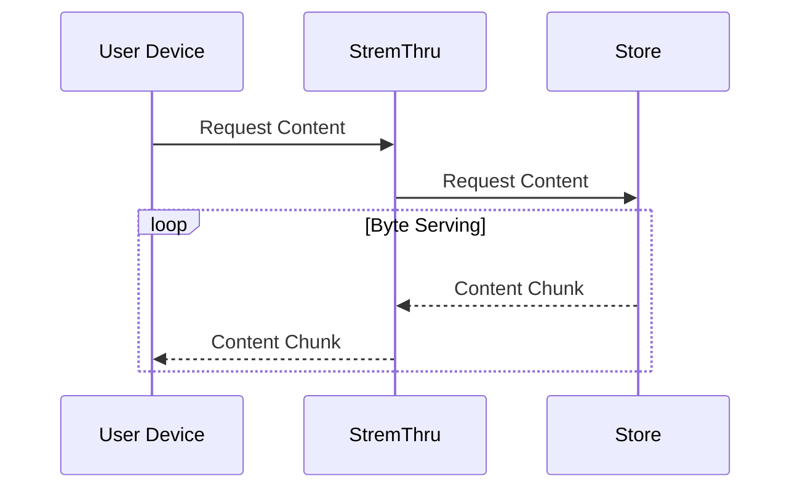
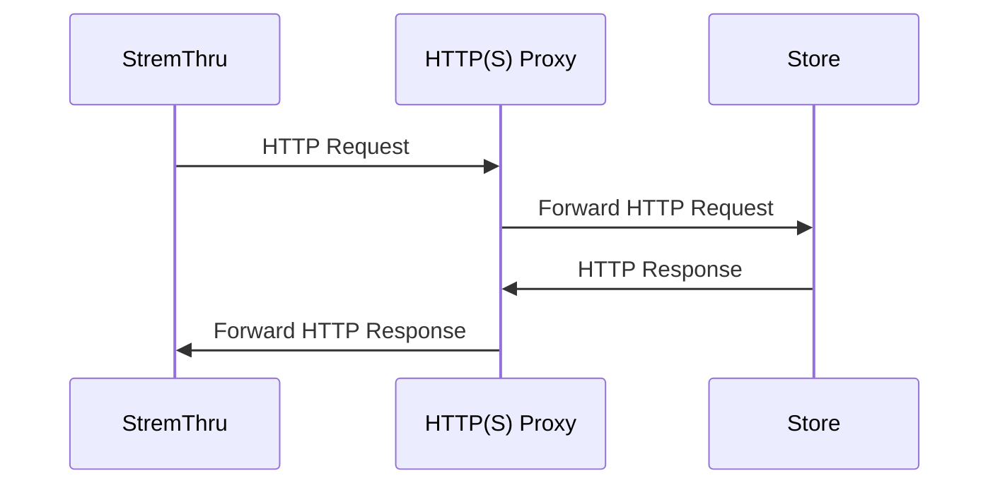

# StremThru

Companion for Stremio.

Check [documentation](https://docs.stremthru.13377001.xyz).

## Features

- HTTP(S) Proxy
- Proxy Authorization
- [Byte Serving](https://en.wikipedia.org/wiki/Byte_serving)

### Store Integration

- [AllDebrid](https://alldebrid.com)
- [Debrider](https://debrider.app)
- [Debrid-Link](https://debrid-link.com/id/4v8Uc)
- [EasyDebrid](https://easydebrid.com)
- [Offcloud](https://offcloud.com/?=ce30ae1f)
- [PikPak](https://mypikpak.com/drive/activity/invited?invitation-code=46013321)
- [Premiumize](https://www.premiumize.me/ref/634502061)
- [RealDebrid](https://stremthru.13377001.xyz/__redirect__/realdebrid-signup)
- [TorBox](https://stremthru.13377001.xyz/__redirect__/torbox-signup)
- [Torrin](https://torrin.app)

### SDK

- [JavaScript](./sdk/js)
- [Python](./sdk/py)

### Concepts

#### Store

_Store_ is an external service that provides access to content. StremThru acts as an interface for the _store_.

#### Store Content Proxy

StremThru can proxy the content from the _store_. For proxy authorized requests, this is enabled by default.

#### Store Tunnel

If you can't access the _store_ using your IP, you can use HTTP(S) Proxy to tunnel the traffic to the _store_.

## Configuration

### MatchLab integration (fork)

Configure `STREMTHRU_INTEGRATION_MATCHLAB_URL` to route torrent parsing,
IMDb matching and AniDB / stream-file mapping through MatchLab. See
[the integration guide](./docs/matchlab.md) for setup, episode rules,
migration details and safety constraints.

The dashboard's **Reset MatchLab Mapping** action only resets MatchLab's
processing marker, retry timestamps and revision for every torrent. The optional
**Also reset parsing** checkbox additionally clears parser state. It does not
truncate IMDb/AniDB tables or rewrite `torrent_stream`. Existing identities
remain visible until MatchLab remaps each torrent; the revision prevents an
in-flight old result from overwriting the newly queued state.

### Torznab feed scraping (fork)

In **Dashboard → Torrent → Indexers**, enable **Scrape Feed (every 10 minutes)**
for any generic Torznab or Jackett indexer. The setting is off by default and
independent of the existing **Only Anime** search setting.

When enabled, the background scheduler requests the indexer's latest results
with `t=search`, an empty `q`, and a 100-item limit every 10 minutes.
Only enabled indexers with **Scrape Feed** checked are contacted; configured
indexer rate limits are respected. Results are deduplicated by the normal
torrent upsert path and later parsed/matched by the existing workers,
including MatchLab when configured. A feed that rejects empty searches is
logged and skipped until its next scheduled run.

Logs now include an INFO summary for each 10-minute cycle and each opted-in
indexer (duration, returned items, valid candidates, rejected items, and magnet
resolution attempts/failures). DEBUG logs provide request/search and upsert
timings. Rate-limit skips and failures are recorded with indexer ID and name.
The `eligible` count is the number submitted to upsert, **not** the number of
new torrents, because existing hashes are deduplicated.

Check [documentation](https://docs.stremthru.13377001.xyz/configuration).

### Stremio Addons

Check [documentation](https://docs.stremthru.13377001.xyz/stremio-addons).

## Sponsors

- [DanaramaPyjama](https://x.com/danaramaps4)
- [Debridio](https://debridio.com)
- [FunkyPenguin](https://github.com/funkypenguin)

## License

Licensed under the MIT License. Check the [LICENSE](./LICENSE) file for details.
